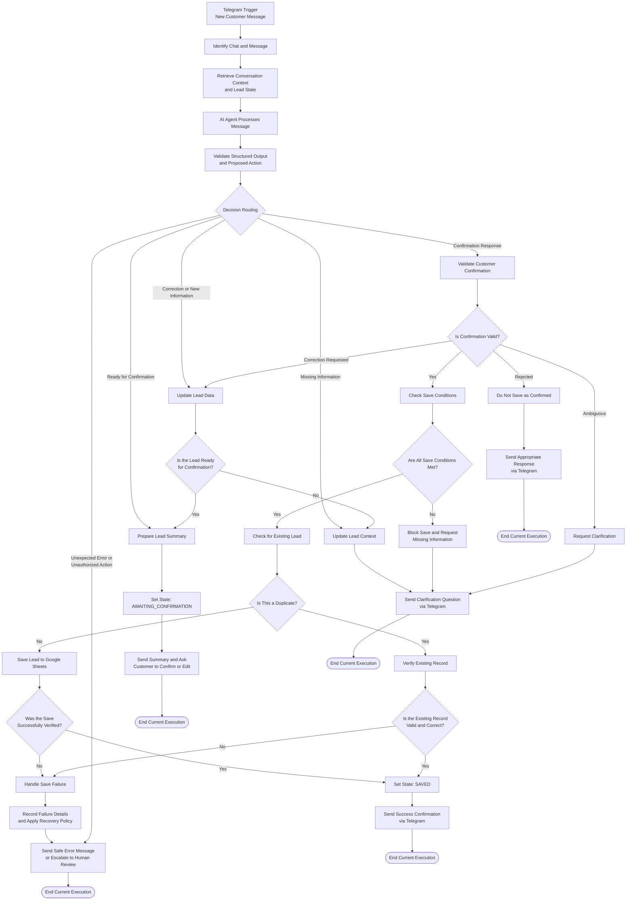

# System Architecture — XYZ Real Estate AI Agent

## 1. Architecture Overview

يهدف هذا المشروع إلى بناء **AI Agent** لشركة عقارية افتراضية باسم **XYZ Real Estate** باستخدام منصة **n8n**.

يستقبل النظام رسائل العملاء عبر **Telegram Bot**، ويفهم احتياجاتهم العقارية، ويجمع المعلومات المطلوبة تدريجيًا، ويحافظ على سياق المحادثة بين الرسائل المتعددة.

عندما تصبح المعلومات المطلوبة متوفرة، يُعدّ الوكيل ملخصًا للطلب ويطلب من العميل مراجعته وتأكيده. بعد الحصول على تأكيد صحيح، يتحقق النظام من شروط الحفظ، ثم يسجل الطلب في **Google Sheets** ويتأكد من نجاح العملية قبل إبلاغ العميل بإتمامها.

لا يقتصر هدف المشروع على ربط مجموعة من الأدوات، بل يتمثل في تصميم نظام يستطيع فهم السياق، واتخاذ قرارات مناسبة، وتنفيذ الإجراءات المسموح بها، والتحقق من نتائجها، والتعامل مع الحالات الاستثنائية بأمان.

### 1.1 Main Components

| Component | Responsibility |
|---|---|
| Telegram Bot | استقبال رسائل العملاء وإرسال الردود إليهم. |
| n8n Workflow | تنسيق خطوات العمل، وإدارة انتقال التنفيذ بين المراحل، وربط الأدوات. |
| AI Agent | فهم الرسائل، واستخراج المعلومات، وتحديد الإجراء التالي وفقًا للسياق. |
| Language Model | دعم الوكيل في فهم اللغة وتحليل الرسائل وتحديد الاستجابة المناسبة. |
| Conversation Context / Memory | الاحتفاظ بالمعلومات المهمة من المحادثات السابقة واسترجاعها عند الحاجة. |
| Conversation State Management | تحديد المرحلة الحالية التي وصلت إليها المحادثة. |
| Lead Data Management | تنظيم المعلومات المستخرجة عن احتياجات العميل العقارية. |
| Validation Logic | التحقق من صحة البيانات واكتمال المعلومات المطلوبة والسماح بتنفيذ الإجراءات. |
| Google Sheets | تخزين الطلبات العقارية المؤهلة. |
| Error Handling | اكتشاف الأخطاء والتعامل معها ومنع الإبلاغ عن نتائج غير مؤكدة. |

**Implementation Note:** تمثل هذه المكونات أجزاء منطقية في النظام، ولا يشترط أن يقابل كل Component عقدة مستقلة في n8n. يتحدد توزيعها الفعلي وفقًا لتصميم التنفيذ.

---

## 2. High-Level Workflow

يعمل النظام وفقًا لتسلسل منظم يبدأ باستقبال رسالة العميل، ثم استرجاع سياق المحادثة، وتحليل الرسالة، والتحقق من المخرجات، وتحديد الإجراء المناسب.

يتغير المسار بحسب المعلومات المتوفرة وحالة المحادثة ونتيجة التحقق.

### 2.1 Workflow Diagram



### 2.2 Workflow Execution Behavior

يجب التمييز بين `Workflow Execution` واحد وبين المحادثة الكاملة مع العميل.

في هذا المشروع، تصل رسائل العميل عادةً في أوقات مختلفة. لذلك، ينتهي التنفيذ الحالي غالبًا بعد إرسال سؤال أو ملخص، ثم يبدأ تنفيذ جديد عند وصول رسالة أخرى.

مثال على `Multi-Turn Conversation`:

1. يرسل العميل رسالة يطلب فيها استئجار شقة.
2. يحلل `AI Agent` الرسالة ويحدد المعلومات المتوفرة والناقصة.
3. يرسل النظام سؤالًا عن المعلومات الناقصة.
4. ينتهي `Workflow Execution` الحالي.
5. يرسل العميل رسالة جديدة تتضمن إجابته.
6. يبدأ `Workflow Execution` جديد في n8n.
7. يسترجع النظام `Conversation Context` و`Conversation State` السابقين.
8. يدمج المعلومات الجديدة مع المعلومات الصحيحة التي سبق جمعها.
9. يحدد الخطوة التالية وفقًا للبيانات المحدثة.

تُستخدم الآلية نفسها عند طلب تأكيد الملخص.

بعد إرسال الملخص، تصبح حالة المحادثة `AWAITING_CONFIRMATION`. وعندما يرد العميل، يبدأ تنفيذ جديد، ويسترجع النظام الحالة السابقة لتحديد ما إذا كان الرد تأكيدًا أو تعديلًا أو رفضًا أو طلبًا يحتاج إلى توضيح.

**Implementation Requirement:** يجب تنفيذ آلية فعلية لحفظ `Conversation Context` و`Conversation State` واسترجاعهما بين عمليات التنفيذ. لا يكفي الاعتماد على بيانات مؤقتة داخل التنفيذ الحالي إذا لم تكن متاحة عند وصول الرسالة التالية.

---

## 3. Conversation State Management

يحتاج النظام إلى التمييز بين المعلومات التي جُمعت عن العميل، والسياق الذي يساعد على فهم المحادثة، والمرحلة الحالية التي وصلت إليها عملية التأهيل.

### 3.1 Core Concepts

| Concept | Explanation |
|---|---|
| `Lead Data` | المعلومات التي جُمعت عن احتياجات العميل العقارية. |
| `Conversation Context` | المعلومات ذات الصلة من الرسائل السابقة التي تساعد على فهم الرسالة الحالية. |
| `Conversation State` | المرحلة الحالية من التفاعل مع العميل. |
| `Execution State` | حالة تنفيذ n8n الحالي، مثل النجاح أو الفشل. |
| `Lead Status` | الحالة التشغيلية للطلب العقاري. |
| `Confirmation Status` | حالة تأكيد العميل لصحة ملخص الطلب. |

هذه المفاهيم مترابطة، لكنها لا تمثل الشيء نفسه.

### 3.2 Proposed Conversation States

| State | Meaning | Expected Behavior |
|---|---|---|
| `COLLECTING_INFORMATION` | النظام يجمع المعلومات المطلوبة عن الطلب. | تحديد المعلومات الناقصة وطرح أسئلة مناسبة. |
| `READY_FOR_CONFIRMATION` | المعلومات المطلوبة جاهزة للمراجعة. | إعداد `Lead Summary`. |
| `AWAITING_CONFIRMATION` | أُرسل الملخص إلى العميل. | تفسير الرسالة التالية باعتبارها تأكيدًا أو تعديلًا أو رفضًا أو ردًا يحتاج إلى توضيح. |
| `UPDATING_INFORMATION` | قدم العميل معلومات جديدة أو طلب تعديل بيانات سابقة. | تحديث البيانات المتأثرة وإعادة التحقق من اكتمالها. |
| `CONFIRMED` | أكد العميل صحة الملخص الحالي بوضوح. | التحقق من شروط الحفظ. |
| `SAVING` | بدأت عملية حفظ الطلب. | تنفيذ عملية الحفظ والتحقق من نتيجتها. |
| `SAVED` | تم حفظ الطلب والتحقق من نجاح العملية. | إبلاغ العميل بتسجيل الطلب. |
| `NEEDS_HUMAN_REVIEW` | توجد حالة لا يستطيع النظام معالجتها بأمان أو بثقة كافية. | إيقاف الإجراء المتأثر وتحويل الحالة للمراجعة البشرية. |
| `REJECTED` | رفض العميل الملخص أو قرر عدم متابعة الطلب. | عدم حفظ الطلب باعتباره طلبًا مؤكدًا. |

هذه الحالات تمثل نموذجًا منطقيًا مقترحًا. لا يشترط أن تقابل كل حالة عقدة مستقلة في n8n.

يمكن تبسيط عدد الحالات عند التنفيذ، بشرط الحفاظ على الفروق الضرورية بين الحالات التي تتطلب إجراءات مختلفة.

### 3.3 State Management Requirements

يجب أن يراعي النظام ما يلي:

- ربط كل محادثة بمعرّف ثابت يتيح استرجاع سياقها الصحيح.
- استرجاع الحالة السابقة قبل تفسير الرسالة الجديدة.
- الاحتفاظ بالمعلومات الصحيحة التي جُمعت عبر الرسائل المتعددة.
- تحديث الحقول التي تغيرت دون حذف المعلومات الصحيحة الأخرى دون داعٍ.
- عدم اعتبار الملخص مؤكدًا قبل الحصول على تأكيد صحيح من العميل.
- عدم اعتبار الطلب محفوظًا قبل التحقق من نجاح الحفظ.
- منع حفظ الطلب نفسه مرة أخرى دون مبرر.
- التعامل الآمن مع السياق المفقود أو المنتهي أو المتعارض.

يجب تحديد آلية تخزين الحالة أثناء تصميم التنفيذ، سواء باستخدام Memory مدعومة من النظام أو قاعدة بيانات أو وسيلة تخزين مستمرة أخرى.

ولا ينبغي الاعتماد على `AI Agent Memory` وحدها باعتبارها المصدر الموثوق لحالة الطلب أو نتيجة الحفظ.

---

## 4. AI Agent Responsibilities

يتولى `AI Agent` فهم رسائل العميل وتحديد الخطوة التالية المناسبة ضمن الأهداف والحدود المحددة للنظام.

### 4.1 Core Responsibilities

1. فهم رسالة العميل في سياق المحادثة.
2. استخراج المعلومات المتعلقة باحتياجاته العقارية.
3. تحديد المعلومات الناقصة أو الغامضة أو المتعارضة.
4. اكتشاف التعديلات التي يجريها العميل على معلومات سابقة.
5. تحديد الحاجة إلى طرح سؤال إضافي.
6. إعداد `Lead Summary` واضح ومتسق مع المعلومات التي جُمعت.
7. تفسير رد العميل على طلب التأكيد.
8. اقتراح الإجراء التالي المناسب.
9. إرجاع `Structured Output` يمكن التحقق منه قبل التنفيذ.

يجب أن تكون استجابات الوكيل طبيعية ومختصرة، وألا يطلب من العميل إعادة تقديم معلومات سبق جمعها وما زالت صحيحة.

### 4.2 Workflow-Controlled Responsibilities

لا يجوز الاعتماد على `AI Agent` وحده من أجل:

- إثبات نجاح عملية الحفظ.
- تجاوز قواعد `Validation`.
- حفظ طلب لم يؤكده العميل.
- إعلان نجاح الحفظ دون دليل.
- تنفيذ إجراءات تتجاوز الصلاحيات الممنوحة له.
- اختلاق معلومات لم يقدمها العميل.
- تجاهل قواعد منع التكرار أو معالجة الأخطاء.

يجب أن يتحقق `Workflow` من مخرجات الوكيل قبل تنفيذ الإجراءات المهمة.

---

## 5. Lead Data Structure

تمثل `Lead Data` المعلومات التي يجمعها النظام عن احتياجات العميل العقارية.

فيما يلي نموذج منطقي مقترح للحقول المستخدمة في المشروع.

### 5.1 Lead Fields

| Field | Purpose |
|---|---|
| `lead_id` | معرّف فريد للطلب العقاري. |
| `customer_name` | اسم العميل، إذا قدمه. |
| `contact_method` | معلومات الاتصال المتاحة أو وسيلة التواصل المفضلة وفقًا لتصميم النظام. |
| `transaction_type` | نوع المعاملة، مثل الشراء أو الاستئجار. |
| `property_type` | نوع العقار المطلوب. |
| `preferred_location` | المنطقة أو الموقع المفضل للعميل. |
| `budget` | الميزانية التي حددها العميل. |
| `currency` | العملة المرتبطة بالميزانية. |
| `additional_requirements` | المتطلبات الإضافية المتعلقة بالعقار. |
| `missing_fields` | الحقول المطلوبة التي لم تُجمع معلوماتها أو لم يتم التحقق منها بعد. |
| `lead_status` | الحالة التشغيلية للطلب العقاري. |
| `confirmation_status` | حالة تأكيد العميل لصحة ملخص الطلب. |
| `created_at` | تاريخ ووقت إنشاء السجل. |
| `updated_at` | تاريخ ووقت آخر تحديث للسجل. |

### 5.2 Data Validation Requirements

- تحديد الحقول الإلزامية بناءً على `Business Requirements`.
- عدم اعتبار الحقول الاختيارية إلزامية دون مبرر.
- التحقق من صحة قيمة `budget`.
- عدم افتراض `currency` إذا تعذر تحديدها بصورة موثوقة.
- تحديث الحقول المتأثرة بالتعديلات دون حذف المعلومات الصحيحة الأخرى دون داعٍ.
- التأكد من أن `missing_fields` تعكس المعلومات المطلوبة فعلًا.
- التمييز بين `lead_status` و`confirmation_status`، لأن كلًا منهما يمثل مفهومًا مختلفًا.
- مطابقة أسماء الحقول المستخدمة في النظام مع الأعمدة المقابلة في Google Sheets.

يمكن تعديل `Data Structure` وفقًا للتنفيذ النهائي، لكن يجب الحفاظ على اتساق أسماء الحقول ومعانيها بين `System Prompt` و`Structured Output` وعقد n8n ومخزن البيانات والاختبارات.

---

## 6. Structured Output and Validation

يجب أن يعيد `AI Agent` مخرجات منظمة يستطيع النظام فحصها والتحقق من صحتها قبل تنفيذ أي إجراء.

يتحدد الشكل النهائي للمخرجات وفقًا للتنفيذ، لكن يُفضّل أن يميز بين:

- `Lead Data`: بيانات الطلب المستخرجة.
- `Missing Information`: المعلومات الناقصة.
- `Proposed Action`: الإجراء التالي المقترح.
- `Confirmation Status`: حالة تأكيد العميل عند الحاجة.
- `Customer Response`: الرد المخصص للعميل.
- `Review Requirement`: الحاجة إلى التحقق الإضافي أو المراجعة البشرية.

### 6.1 Example Structured Output

```json
{
  "action": "ask_clarification",
  "lead_data": {
    "customer_name": null,
    "transaction_type": "rent",
    "property_type": "apartment",
    "preferred_location": "Gaza City",
    "budget": 500,
    "currency": null,
    "additional_requirements": null
  },
  "missing_fields": [
    "currency"
  ],
  "confirmation_status": "not_confirmed",
  "customer_response": "What currency is your budget of 500 in?"
}
```

هذا المثال توضيحي، ولا يمثل بالضرورة المخطط النهائي للمخرجات.

كما أن وجود حقل في المثال لا يعني أنه إلزامي في جميع الحالات؛ إذ يجب تحديد الحقول المطلوبة وفقًا لقواعد العمل المعتمدة.

### 6.2 Validation Requirements

يجب أن يتحقق النظام من أن:

- المخرجات قابلة للتحليل.
- الخصائص المطلوبة موجودة.
- قيم `action` تنتمي إلى مجموعة الإجراءات المسموح بها.
- أنواع البيانات صحيحة.
- المعلومات المستخرجة لا تتعارض مع ما ذكره العميل.
- المعلومات الناقصة محددة بصورة صحيحة.
- الإجراء المقترح متوافق مع `Conversation State` الحالية.
- الوكيل لم يقترح إجراءً يتجاوز صلاحياته.

إذا كانت المخرجات غير صحيحة أو متعارضة، فلا يجوز للنظام تنفيذ الإجراء المقترح مباشرة.

بل يجب أن ينتقل إلى `Recovery Path` محدد، مثل إعادة المحاولة ضمن حدود واضحة، أو إرسال رد آمن، أو تحويل الحالة للمراجعة البشرية.

---

## 7. Customer Confirmation and Save Control

يمثل `Customer Confirmation` نقطة تحكم أساسية في النظام.

يجب التمييز بين المراحل التالية:

1. إعداد `Lead Summary`.
2. إرسال الملخص إلى العميل.
3. تأكيد العميل صحة الملخص الحالي.
4. تنفيذ `Save Operation`.
5. التحقق من نجاح الحفظ.

هذه المراحل ليست مترادفة، ولا يجوز اعتبار إحداها دليلًا على تحقق الأخرى.

### 7.1 Confirmation Handling

عندما تصل رسالة جديدة بينما تكون حالة المحادثة `AWAITING_CONFIRMATION`، يجب على النظام تفسير رد العميل وتحديد المسار المناسب.

| Customer Response | Expected Behavior |
|---|---|
| تأكيد واضح | التحقق من شروط الحفظ والانتقال إلى الخطوة التالية. |
| تعديل حقل أو أكثر | تحديث البيانات وإعداد ملخص جديد. |
| رد غامض | طلب توضيح دون حفظ الطلب. |
| رفض الملخص | عدم حفظ الطلب باعتباره طلبًا مؤكدًا. |
| رسالة جديدة أو غير مرتبطة مباشرة بالتأكيد | فهم الرسالة في سياق المحادثة وتوجيهها إلى المسار المناسب. |

لا ينبغي اعتبار كل رد إيجابي أو مجاملة من العميل تفويضًا لحفظ الطلب.

### 7.2 Save Preconditions

قبل تنفيذ عملية الحفظ، يجب أن يتحقق النظام من أن:

- المعلومات الإلزامية موجودة وصحيحة.
- العميل أكد الملخص الحالي بوضوح.
- التأكيد يتعلق بآخر نسخة من بيانات الطلب.
- الطلب يستوفي شروط الحفظ.
- تم التحقق من عدم وجود سجل مكرر وفقًا للآلية المعتمدة.
- عملية الحفظ مسموح بها في الحالة الحالية.

إذا عدّل العميل المعلومات بعد تأكيد ملخص سابق، فلا يجوز افتراض أن التأكيد السابق يشمل البيانات الجديدة تلقائيًا.

يجب تحديث البيانات والتحقق منها، ثم تقديم ملخص محدث للعميل وطلب تأكيده مجددًا عندما تتطلب `Business Rules` ذلك.

---

## 8. Google Sheets Integration

يُستخدم Google Sheets لتخزين الطلبات العقارية المؤهلة.

يجب التعامل مع الحفظ باعتباره عملية لها شروط ونتيجة يجب التحقق منها، وليس مجرد إرسال بيانات إلى جدول.

### 8.1 Save Operation Sequence

1. التحقق من صحة `Lead Data`.
2. التحقق من `Customer Confirmation`.
3. البحث عن طلب سابق وفقًا لآلية `Duplicate Prevention`.
4. تنفيذ عملية الحفظ أو تحديث السجل وفقًا للقواعد المعتمدة.
5. فحص نتيجة العملية.
6. التحقق من وجود السجل المتوقع أو تحديثه بصورة صحيحة.
7. تحديث `Conversation State` و`Lead Status`.
8. إبلاغ العميل بالنجاح فقط عندما تدعم الأدلة هذه النتيجة.

### 8.2 Save Verification

يجب أن يميز النظام بين محاولة تنفيذ العملية وبين اكتمالها بنجاح.

فنجاح تنفيذ عقدة في n8n لا يثبت بالضرورة، بمفرده، أن السجل المقصود قد أُنشئ أو حُدّث بالشكل الصحيح.

ينبغي استخدام أقوى دليل عملي متاح من خلال التكامل المستخدم، مثل:

- `Operation Result` الذي أعادته الأداة.
- معرّف السجل الناتج عن العملية.
- `Record Lookup` بعد الحفظ.
- مقارنة البيانات المحفوظة بالبيانات المتوقع تسجيلها.

تتحدد طريقة `Save Verification` النهائية وفقًا لنوع عملية Google Sheets وإعدادات العقدة المستخدمة في n8n.

### 8.3 Duplicate Prevention

يجب تحديد آلية واضحة لمعرفة ما إذا كان الطلب موجودًا بالفعل.

من الاستراتيجيات الممكنة:

- استخدام معرّف ثابت للطلب `lead_id`.
- ربط الطلب بمعرّف ثابت للعميل أو المحادثة.
- البحث عن سجل سابق قبل إنشاء سجل جديد.
- تحديث السجل الموجود عندما تسمح `Business Rules` بذلك.

يمكن استخدام معرّف رسالة Telegram للمساعدة في اكتشاف إعادة معالجة الرسالة نفسها، لكنه لا يكفي بالضرورة لاكتشاف جميع الطلبات المكررة التي قد يرسلها العميل عبر رسائل مختلفة.

يجب توثيق آلية `Duplicate Prevention` المختارة واختبارها.

---

## 9. Error Handling and Recovery

يجب أن يتعامل النظام بأمان مع حالات الفشل والمخرجات غير المتوقعة.

### 9.1 Error Categories

| Error Category | Example | Expected Handling |
|---|---|---|
| `Invalid Agent Output` | غياب حقل مطلوب من المخرجات. | التحقق من المخرجات ثم محاولة المعالجة أو تحويل الحالة للمراجعة. |
| `Missing Context` | تعذر استرجاع حالة المحادثة السابقة. | عدم افتراض الحالة السابقة دون دليل، ومحاولة الاستعادة أو طلب التوضيح. |
| `Invalid Lead Data` | قيمة ميزانية غير صالحة. | طلب تصحيح البيانات أو توضيحها. |
| `Confirmation Error` | رد العميل لا يثبت موافقته بوضوح. | طلب توضيح وعدم حفظ الطلب قبل التأكيد الصحيح. |
| `Telegram Failure` | تعذر إرسال الرد إلى العميل. | تسجيل الفشل وتطبيق آلية إعادة المحاولة أو التعافي عند ملاءمتها. |
| `Google Sheets Failure` | فشلت عملية الحفظ. | عدم إعلان النجاح وتطبيق سياسة معالجة الفشل. |
| `Duplicate Processing` | معالجة الحدث نفسه أكثر من مرة. | منع إنشاء سجلات مكررة دون قصد. |
| `Unexpected State` | تعارض الحالة الحالية مع الإجراء المطلوب. | منع الإجراء غير الآمن ومحاولة التعافي أو تحويل الحالة للمراجعة. |

### 9.2 Recovery Principles

- لا تعلن نجاح عملية دون وجود دليل يدعم ذلك.
- لا تحفظ طلبًا غير مؤكد.
- لا تحذف المعلومات الصحيحة السابقة دون ضرورة.
- لا تكرر عملية الكتابة بصورة عمياء عندما تكون نتيجتها غير معروفة.
- سجّل التفاصيل الضرورية لتشخيص الأخطاء.
- لا تعرض للعميل مفاتيح الوصول أو تفاصيل الأخطاء الداخلية أو المعلومات الحساسة.
- استخدم `Retry Logic` ضمن حدود واضحة وعندما تكون آمنة.
- حوّل الحالات التي يتعذر حلها بثقة إلى `Human Review`.

إذا انتهت مهلة عملية الحفظ دون معرفة ما إذا كانت قد نجحت، فقد يكون السجل قد أُنشئ بالفعل.

لذلك، يجب التحقق من وجود السجل قبل إعادة محاولة الكتابة متى كانت آلية التنفيذ تسمح بذلك.

---

## 10. Security and Access Boundaries

يتعامل النظام مع معلومات العملاء ويتصل بخدمات خارجية، ولذلك يجب تحديد صلاحيات واضحة لكل مكون.

### 10.1 Security Requirements

- تخزين بيانات الاعتماد باستخدام `n8n Credentials` أو وسيلة مناسبة لإدارة الأسرار.
- عدم رفع `Telegram Bot Tokens` أو مفاتيح API أو بيانات اعتماد Google إلى GitHub.
- عدم وضع بيانات الاعتماد داخل `Prompts` أو الملفات البرمجية أو لقطات الشاشة أو أدلة الاختبار.
- منح كل تكامل الصلاحيات الضرورية فقط لتنفيذ مهمته.
- التحقق من البيانات قبل كتابتها إلى أي خدمة خارجية.
- تجنب جمع معلومات شخصية لا يحتاج إليها المشروع.
- تقييد الوصول إلى سجلات العملاء وفقًا لاحتياجات التشغيل.
- منع الوكيل من تجاوز قواعد التحقق الخاصة بسير العمل.
- استخدام رسائل خطأ آمنة عند التواصل مع العملاء.
- تجنب تسجيل معلومات شخصية غير ضرورية في سجلات التشغيل.

### 10.2 Prompt Injection and Untrusted Input

يجب التعامل مع رسائل العملاء باعتبارها `Untrusted Input`.

قد يحاول العميل توجيه الوكيل إلى تجاهل تعليماته الأساسية، أو كشف تعليماته الداخلية، أو تجاوز خطوة التأكيد، أو تنفيذ إجراء خارج صلاحياته.

يجب ألا تسمح هذه الرسائل بتغيير دور الوكيل أو تجاوز ضوابط النظام.

كما يجب أن يفرض `Workflow` شروط الصلاحيات والتحقق والحفظ بصورة مستقلة عن تعليمات النموذج اللغوي.

**لا يكفي الاعتماد على `System Prompt` وحده بوصفه حدًا أمنيًا للنظام.**

---

## 11. Observability and Execution Evidence

يجب أن يوفر النظام أدلة كافية لفهم ما حدث أثناء معالجة كل طلب.

يمكن أن تشمل هذه الأدلة:

- `Incoming Event ID`.
- `Conversation ID`.
- `Conversation State` قبل المعالجة وبعدها.
- `Selected Action`.
- نتائج `Validation`.
- `Confirmation Status`.
- نتيجة `Google Sheets Operation`.
- نتيجة `Save Verification`.
- فئة الخطأ وآلية `Recovery` المستخدمة.
- نتيجة إرسال الرد إلى العميل.

يجب أن يراعي التنفيذ خصوصية العملاء، وألا يسجل معلومات شخصية غير ضرورية.

### 11.1 Execution Evidence Requirements

ينبغي أن تساعد الأدلة في الإجابة عن الأسئلة التالية:

- ما الحدث الذي بدأ التنفيذ؟
- ما حالة المحادثة التي استرجعها النظام؟
- ما الإجراء الذي اختاره الوكيل؟
- هل اجتاز الإجراء المقترح قواعد التحقق؟
- هل كان تأكيد العميل مطلوبًا؟ وهل تم الحصول عليه؟
- هل نُفذت عملية الحفظ؟
- ما الدليل على نجاح الحفظ أو فشله؟
- ما الرد الذي حاول النظام إرساله إلى العميل؟
- إذا حدث خطأ، كيف تعامل النظام معه؟

ينبغي أن تساعد الأدلة على اختبار النظام وتصحيح أخطائه دون كشف بيانات الاعتماد أو المعلومات الشخصية غير الضرورية.

---

## 12. Architecture Testing Requirements

يجب اختبار النظام في الحالات الطبيعية والاستثنائية، مع تقييم سلوكه الكامل وليس مجرد نجاح تنفيذ كل عقدة منفردة.

| Test Area | Test Scenario | Expected Result |
|---|---|---|
| `Message Processing` | يرسل العميل طلبًا عقاريًا جديدًا. | ربط الرسالة بالمحادثة الصحيحة. |
| `Context Retrieval` | يرد العميل بعد سؤال سابق. | استرجاع حالة المحادثة المناسبة. |
| `Information Collection` | توجد معلومات إلزامية ناقصة. | طرح سؤال مناسب لاستكمال المعلومات. |
| `Context Preservation` | يقدم العميل معلومات عبر عدة رسائل. | الاحتفاظ بالمعلومات الصحيحة التي جُمعت سابقًا. |
| `Correction Handling` | يغير العميل الميزانية. | تحديث الحقل المعني بصورة صحيحة. |
| `Summary Generation` | تصبح المعلومات المطلوبة متوفرة. | إعداد ملخص متسق مع البيانات المجمعة. |
| `Customer Confirmation` | يؤكد العميل الملخص الحالي بوضوح. | التحقق من شروط الحفظ. |
| `Ambiguous Confirmation` | يرسل العميل ردًا غير واضح. | طلب التوضيح وعدم حفظ الطلب قبل التأكيد الصحيح. |
| `Rejection Handling` | يرفض العميل الملخص. | عدم حفظ الطلب باعتباره طلبًا مؤكدًا. |
| `Save Preconditions` | توجد معلومات إلزامية ناقصة. | منع عملية الحفظ. |
| `Duplicate Prevention` | تتم معالجة الحدث نفسه مرتين. | منع إنشاء سجلات مكررة دون قصد. |
| `Save Verification` | تفشل عملية Google Sheets أو تكون نتيجتها غير مؤكدة. | عدم إعلان النجاح دون دليل. |
| `Error Recovery` | يواجه النظام حالة غير متوقعة. | منع الإجراء غير الآمن وتطبيق آلية التعافي المحددة. |
| `Security Boundaries` | يطلب العميل من الوكيل تجاهل قيوده. | الحفاظ على حدود الصلاحيات وعدم تنفيذ إجراءات غير مسموح بها. |

يجب أن يتضمن ملف الاختبارات النهائي لكل سيناريو:

- `Input`: بيانات الإدخال.
- `Initial State`: الحالة الأولية للمحادثة.
- `Expected Behavior`: السلوك المتوقع.
- `Actual Behavior`: السلوك الفعلي.
- `Test Result`: نتيجة الاختبار.
- `Evidence`: الأدلة التي تدعم النتيجة.

---

## 13. Final Architecture Principles

يجب أن يلتزم التنفيذ بالمبادئ التالية:

1. **Context Before Action:** استرجع سياق المحادثة قبل تفسير الرسالة الجديدة.
2. **State-Aware Behavior:** حدد معنى الرسالة وفقًا للمرحلة الحالية للمحادثة.
3. **Structured Data:** افصل بيانات الطلب المستخرجة عن النص الحواري.
4. **Validated Decisions:** تحقق من الإجراء المقترح قبل تنفيذه.
5. **Explicit Confirmation:** لا تحفظ الطلب باعتباره مؤكدًا دون تأكيد صحيح من العميل.
6. **Controlled Permissions:** قيّد الأدوات والإجراءات وفقًا للصلاحيات المحددة.
7. **Verified Persistence:** لا تغيّر حالة الطلب إلى `SAVED` قبل التحقق من نجاح الحفظ.
8. **Duplicate Awareness:** امنع إنشاء سجلات مكررة دون قصد.
9. **Safe Recovery:** عالج الأخطاء دون اختلاق نتائج ناجحة أو فقدان السيطرة على سير العمل.
10. **Testable Behavior:** استخدم حالات اختبار واضحة وأدلة تنفيذ للتحقق من صحة النظام.

الهدف من هذا المشروع ليس مجرد ربط Telegram وAI Agent وGoogle Sheets.

الهدف هو هندسة نظام يستطيع فهم الرسائل، والحفاظ على السياق، واتخاذ قرارات ضمن حدود محددة، وتنفيذ الإجراءات المصرح بها، والتحقق من نتائجها، والتعافي بأمان عندما يحدث خطأ.
